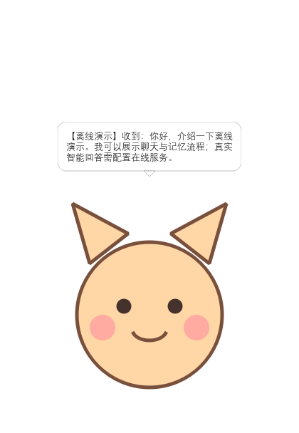
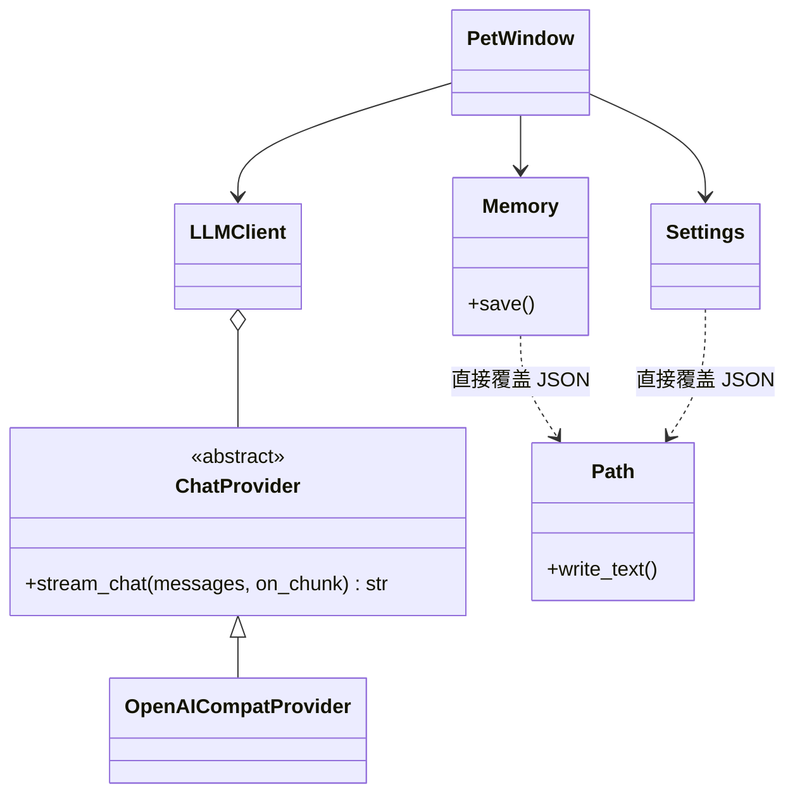
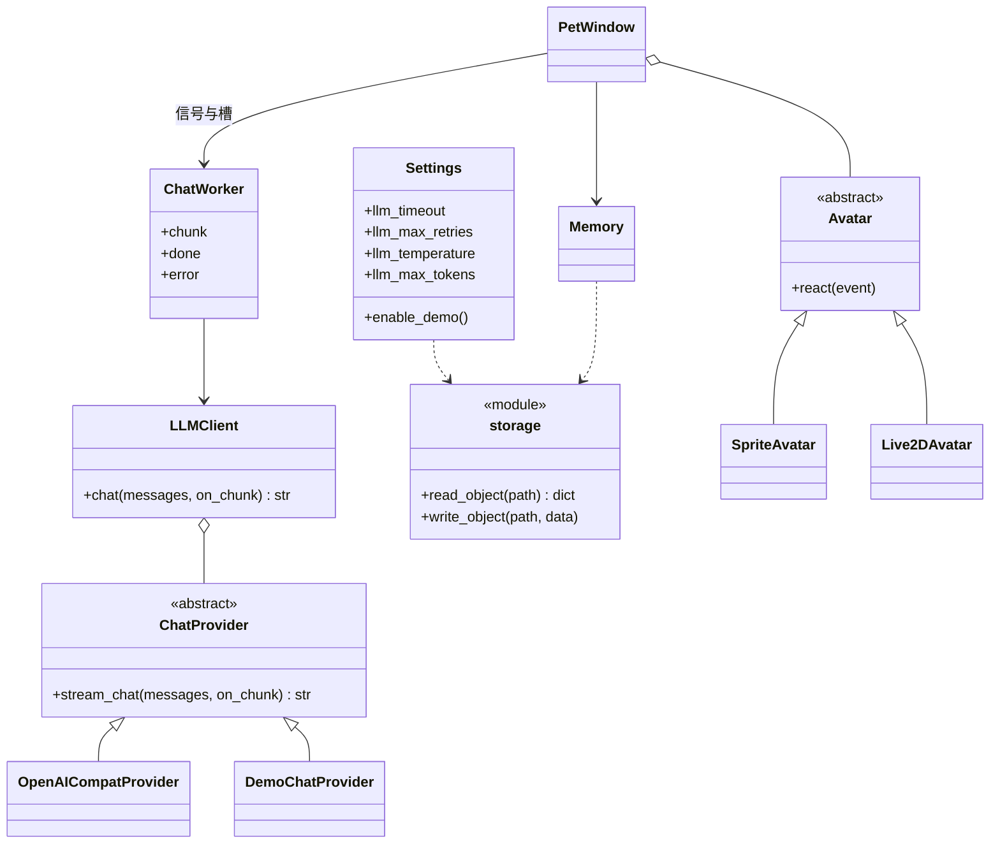
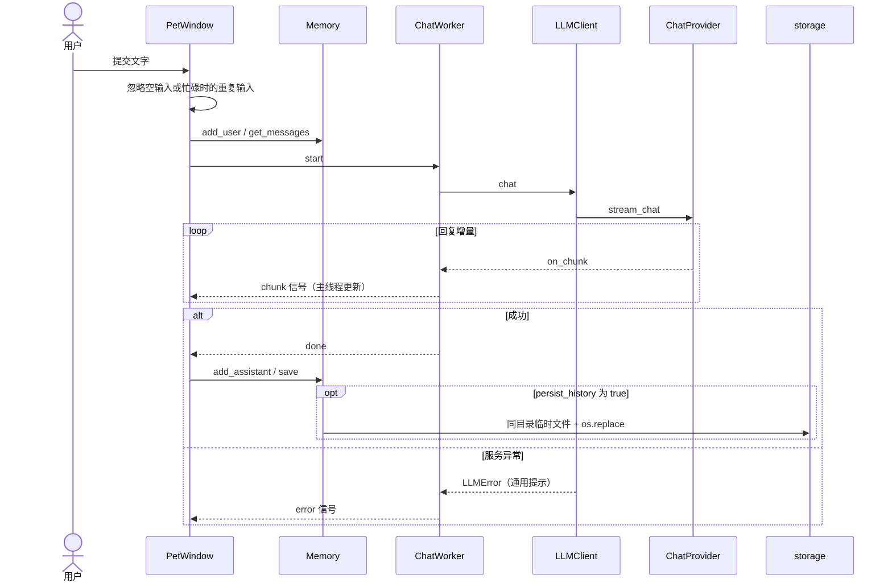

# 设计开发报告：智能桌面宠物

> 提交索引见 [评审对照表](assessment.md)。区分 Git 可验证事实、实测结果与未完成事项，不以模式数量或代码行数代替质量。

## 1. 目标、范围与复杂性

软件面向 Windows 桌面：透明置顶形象、文字聊天、语音识别与合成、跨会话记忆、人设切换、全局快捷键，以及图片/Live2D 双渲染引擎。复杂性来自 GUI 事件循环、后台线程、流式网络、音频设备、文件持久化和嵌入 Chromium 的协作。

Linux CI 验证无头运行与逻辑可移植性，不等于已部署生产服务器。项目没有嵌入式硬件实现，不宣称满足硬件开发能力展示。

图 1：程序实际绘制的内置猫形象与离线回复，无需第三方模型或在线密钥。录像及复现方法见 [演示说明](demo.md)。

## 2. 可验证的演进与问题

| 阶段 | Git 依据 | 可验证事实 |
|---|---|---|
| 最早的引擎版本 | `5e6aaa2` | 已有配置、引擎和 ChatProvider 抽象，并不是单文件 MainWindow |
| 双形象策略 | `48144c1` | 引入 Avatar、SpriteAvatar、Live2DAvatar，窗口通过工厂选择形象 |
| 模型通用化 | `08c31ca` | 从模型元数据发现入口、动作和表情，减少特定模型耦合 |
| 本轮改进前 | `c1f0c80` | 22 个 pet 模块、32 个测试函数、唯一在线对话策略；直接写 JSON |
| 本轮改进 | [Issue #5](https://github.com/Yunkimo/Intelligent-Desk-Pet/issues/5) | 第二种对话策略、文件边界、隔离测试和请求参数注入 |

旧报告中的“单文件原型使用 requests/pyttsx3”“900 行”“14 个用例”缺少当前证据，已移除。本轮基线与原本地 `d382e0a` 文件树一致，使用远端 `c1f0c80` 作为可克隆的比较基线。

### 2.1 改进前 UML

已有分层使局部修改成为可能，但演示依赖密钥；覆盖写入失败可能损坏旧文件；历史缺少结构过滤；单测受真实配置和平台差异影响；请求超时与重试没有显式配置。

### 2.2 改进后 UML

`create_chat_provider(settings)` 选择在线或离线策略，共享回调和返回值契约，窗口与 LLMClient 不判断服务商。文件操作集中到 storage 模块，调用者负责数据语义。

### 2.3 时序图

离线 GUI 与 CLI 关闭历史读写、TTS 和录音。网络超时限制单次请求/读写等待，重试和流式响应可能延长总时长，不是整段对话的严格截止时间。

## 3. 模式选择、动机和代价

| 方法 | 代码位置 | 收益与边界 |
|---|---|---|
| 策略 Strategy | providers.py、avatar.py | 两种对话实现证明替换能力；不代表支持任意非兼容协议 |
| 简单工厂 Simple Factory | create_chat_provider、create_avatar | 集中选择实现；没有 Creator 子类覆写创建操作，所以不是 GoF 工厂方法 |
| 适配器 Adapter | OpenAICompatProvider、ASREngine、TTSEngine | 第三方协议转为项目接口，限制升级影响范围 |
| 观察者 Observer | worker.py 的 Qt 信号/槽 | 将结果派发给主线程；不能保证所有 UI 工作都无阻塞 |
| 外观 Facade | LLMClient | 统一对话入口与异常边界；PetWindow 是窗口编排器，不因贴上模式名称就符合单一职责 |
| 依赖注入与持久化边界 | LLMClient(provider)、storage.py | 可替换策略、注入文件故障；未为两个 JSON 文件引入复杂数据库层 |

后端引擎不依赖 Qt；Worker 负责线程桥接。Live2D HTML/JS 负责渲染，Python 负责业务与窗口。PetWindow 仍偏大，后续可在测试保障下拆分对话/音频控制器；本轮未宣称完全解耦。

## 4. 方法与量化效果

1. 从 Git 导出基线，在相同环境运行原有用例，记录失败。
2. 为文件替换失败、无效历史、配置边界、错误隐私和跨平台功能键补测试。
3. 增加离线策略和 CLI/GUI 自检，验证窗口、线程、信号与记忆往返。
4. 增加格式钩子、跨平台 CI、依赖审计和只读度量，以报告校正文档。

结果与环境见 [验证报告](validation.md)，小型原始证据见 [metrics.json](evidence/metrics.json) 和 [test-results.json](evidence/test-results.json)。行数增长来自新能力和格式调整，不是性能提升证据。未测量真实 LLM 首 token 延迟、ASR 错误率或 TTS 成功率，不声称这些指标改善。

## 5. 限制与后续

- 在线 LLM/TTS、麦克风、Live2D GPU 渲染与打包仍需人工验收。
- Live2D WebEngine 安全开关和模型来源需进一步收紧，见安全文档。
- 团队身份、实际工时与 KPI 待成员确认；作者统计不证明全部劳动。
- 最终提交材料和未完成事项见 [评审对照表](assessment.md)。
