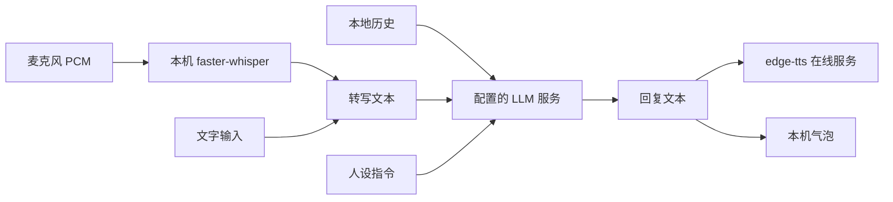

# 信息安全设计与边界

## 1. 数据流

ASR 在本机推理，**转写文本仍发送给 LLM**；最近历史与人设也随对话请求发送。开启 TTS 时回复发送给 edge-tts 服务。本地 JSON 不会作为文件自动上传，但其中消息会进入后续请求。首次 ASR 可能访问模型下载服务，不能宣称仅 LLM/TTS 两类外联。

## 2. 控制措施与验证

| 风险 | 实现或使用要求 | 验证 |
|---|---|---|
| 密钥进入仓库 | 忽略 .env/运行数据；示例用占位符 | check_repo.py 检查索引敏感文件及明显密钥形式 |
| 服务错误泄漏 | LLMClient 对 UI 返回通用错误，本地保留异常链 | test_error_does_not_expose_provider_payload |
| 覆盖写入失败 | 临时文件、flush/fsync、os.replace；失败清理 | test_failed_replace_preserves_original |
| 历史污染 | 仅加载 user/assistant 文本；system 从当前人设建立 | test_loaded_history_filters_invalid_entries_and_system |
| 资源等待 | 超时、有限重试、生成上限和录音时长可配置 | 配置边界与工厂参数测试 |
| 演示误发送 | 离线不创建 SDK 客户端；关闭音频/历史持久化 | test_demo.py、test_window_demo.py |

输入和回复不作为代码或命令执行。提示注入仍可能影响回复，角色提示不是安全沙箱。历史是明文；敏感对话请关闭 persist_history，并自行删除不再需要的历史。

## 3. 已知限制

- Live2D 使用 `--disable-web-security --allow-file-access-from-files` 兼容本地模型，扩大 WebEngine 信任边界。仅加载可信资源；后续应改为受限资源协议/请求拦截并去除全局开关。本轮未宣称修复。
- 模型/第三方运行时有独立许可；MIT 不自动覆盖它们，见 [供应链说明](supply-chain.md)。
- 原子替换不提供加密、跨进程事务或全部断电场景的数据保证。应用目录需可写。
- pip-audit 仅覆盖 Python 已知漏洞数据库，不覆盖所有 JS/模型/Qt/系统组件，也不能证明无未知漏洞。
- 索引扫描不证明历史从未泄漏；发现密钥后先撤销再清理历史。

## 4. 漏洞反馈

公开 Issue 只提交脱敏复现和日志，不上传 .env、完整对话或录音。泄漏密钥应在服务商端撤销并重新生成。项目没有独立安全响应团队，不承诺固定响应时间。
